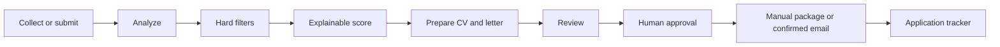

# Job Agent

An AI agent that helps with job search: it reads job posts, scores how well
they fit my profile, and prepares a CV choice and cover letter for review.

The decision logic is written by hand. It is simple and every score can be
explained.

## Design decisions

- The agent never invents skills or experience. It only uses `data/profile.yaml`.
- Skill level and project tech stack are kept separate. Using a skill does not
  prove that a project used it.
- `data/skills.yaml` is only a vocabulary to recognize skills in job posts.
  A skill listed there is not mine unless it is also in `profile.yaml`.
- Missing skills are shown as `missing_skills`. They are never added to the profile.
- Synonyms are true synonyms only. Related technologies are separate skills.
- Rules handle collecting, filtering, scoring, review, and statuses; there is no
  paid LLM in the required workflow.
- A local embedding model supports semantic matching, while application claims
  come only from the confirmed profile and a plain template.
- Every match result shows each part of the score and the reason.
- Profile version and matcher version are saved with each result.
- The embedding model is loaded once at app start.
- A human approves every application.



## Stages

| # | Stage | Status |
|---|-------|--------|
| 1 | Foundation + job analysis + matching | done |
| 2 | Automatic public API collectors | done |
| 3 | CV selection + cover letter + reviewer | done |
| 4 | Human approval + tracker + dashboard | done |
| 5 | Manual application package + safe email + GitHub polish | done |

## Quick start

```bash
python -m venv .venv
source .venv/bin/activate        # Windows: .venv\Scripts\activate
pip install -r requirements.txt
uvicorn app.main:app --reload
```

The API listens at `http://127.0.0.1:8000`. Open Swagger at
`http://127.0.0.1:8000/docs` to try the endpoints.

For a local flow that needs no API key, internet access, or model download, run
`python -m scripts.demo`. Tests use the same deterministic fake embedder.

## Main commands

- Start the API: `uvicorn app.main:app --reload`
- Run tests: `python -m pytest`
- Collect jobs: `python -m scripts.collect --source remotive --search java --limit 30`
- Run the offline end-to-end demo: `python -m scripts.demo`
- Evaluate labeled jobs: `python -m scripts.evaluate`
- Try one saved job: `python -m scripts.try_match job.txt --title "Junior Java Developer" --remote --eligible Azerbaijan`

### API

Paste a job post with `POST /jobs`:

```json
{
  "title": "Junior Java Backend Developer",
  "company": "Example Tech",
  "description": "We are looking for a junior Java developer. Requirements include Java, Spring Boot, and PostgreSQL. Build backend services with the team.",
  "remote_type": "remote",
  "remote_work_eligibility": "eligible",
  "eligible_countries": ["Azerbaijan"]
}
```

Stage 1 endpoints:

- `POST /jobs` — save, analyze and match a job; duplicates return the existing job.
- `GET /jobs` — list jobs; optional `decision`, `min_score`, `limit` and `offset` filters.
- `GET /jobs/{id}` — get a job with its latest analysis and match.
- `GET /jobs/{id}/matches` — compare the job's full match history.
- `POST /jobs/{id}/rematch` — add a match using the active profile.
- `GET /profile` — show the active profile summary.
- `POST /profile/reload` — load profile changes from `data/profile.yaml`.
- `GET /health` — check API and matching runtime status.
- `POST /collectors/{source}/run` — run `remotive` or `remoteok` (`search` and `limit` are optional).
- `GET /collectors/runs` — list recent collector runs and their counts/errors.
- `POST /jobs/{id}/prepare` — select a registered CV and prepare a reviewed cover letter.
- `GET /applications/{id}` — retrieve a prepared application.

## Stage 2 collectors

Collectors use the Remotive and RemoteOK public JSON APIs; they do not scrape
HTML pages. Each job is passed through the same analysis and matching pipeline
as a manually submitted job. Unclear remote-country eligibility is left for
manual review, and duplicates are counted without saving another job.

Run one collector from the project root:

```bash
python -m scripts.collect --source remotive --search "java" --limit 30
python -m scripts.collect --source remoteok --search "java" --limit 30
```

The collector runner allows at most four runs per source in 24 hours and at
least 60 seconds between runs of the same source. Each attempt, including a
failed run, is recorded in `collector_runs`.

RemoteOK requires a link back and attribution. Read their terms before using it.

To run a collector daily, create a Windows Task Scheduler task with the project's
`.venv\Scripts\python.exe` as the program, `-m scripts.collect --source remotive
--search java --limit 30` as the arguments, and the project root as “Start in”.
Create a separate task for RemoteOK if you want both sources. On cron-based
systems, an example daily Remotive task is:

```cron
0 8 * * * /path/to/job-agent/.venv/bin/python -m scripts.collect --source remotive --search java --limit 30
```

## Stage 3 application preparation

`POST /jobs/{id}/prepare` is available for jobs whose latest match is `queued`
or `needs_review`. It chooses a CV from `data/cvs.yaml`, writes a short letter
from confirmed profile facts, and returns reviewer issues with the application.
Repeated preparation refreshes the same application only while its status is
`prepared`; it cannot overwrite a later human status. A `needs_review` job is
prepared with a warning so its eligibility can be checked by a person.

The three entries in `data/cvs.yaml` are examples marked `EXAMPLE, EDIT ME`.
Update their target roles, emphasis skills, and PDF file paths to match the CVs
you actually have. The loader checks skills and roles against the profile and
vocabulary. Missing PDFs are warnings: add the real personal PDFs under
`data/cvs/` when ready; PDF files are ignored by Git. The letter uses only
profile-confirmed hands-on skills, labels studied skills as learning, and never
copies missing job skills into its claims. Review the returned letter and
issues yourself; this phase does not approve or send applications.

Run the API as shown in Stage 1 setup, then submit and prepare a job using the
endpoints above. The selected CV identifier and selection reason, letter, and
review issues are returned by the prepare endpoint.

## Stage 4 approvals and dashboard

Start the API with `uvicorn app.main:app --reload`, then open
`http://127.0.0.1:8000/ui`. The dashboard lists jobs by final score, shows the
match explanation and skills, and links to the original post. Open a job to
prepare its application, review the CV choice and letter, approve or skip it,
change its status, and view its status history. `/ui/stats` shows application
counts, latest match decisions, average final score, and applications per week.
Screenshot: add here.

The JSON API provides:

- `POST /applications/{id}/approve` and `POST /applications/{id}/skip`.
- `POST /applications/{id}/status` to record a later status and optional note.
- `GET /applications` with optional `status`, `limit`, and `offset` filters.
- `GET /applications/{id}/events` and `GET /stats`.

Illegal status changes and refused approvals return HTTP 409 with the reasons.
Approval requires a reviewed letter, a selected CV, and—for `needs_review`
jobs—`eligibility_checked=true` after the owner checks the eligibility
information.

Application status transitions are:

| Current status | Allowed next statuses |
|----------------|-----------------------|
| `prepared` | `approved`, `skipped` |
| `approved` | `package_ready`, `sent`, `skipped`, `prepared` |
| `package_ready` | `sent`, `skipped` |
| `sent` | `replied`, `interview`, `rejected`, `withdrawn` |
| `replied` | `interview`, `rejected`, `withdrawn` |
| `interview` | `rejected`, `withdrawn` |
| `skipped` | `prepared` |
| `rejected`, `withdrawn` | no further transitions |

Every status change is recorded in `application_events`. The application is
never sent automatically; approval is a human decision.

## Stage 5 sending and final polish

After approval, **Prepare package** creates `outbox/<job_id>_<company>/` with
the selected CV when available, `letter.txt`, `job.txt` (including the match
explanation), and a `README.txt` with the original application link. The outbox
is local and ignored by Git. If the example CV PDF is missing, the package is
still created with a clear note; add the real PDF under `data/cvs/` before
applying.

Email is optional and disabled from real delivery by default. The dashboard's
**Send email** action first opens a separate confirmation page showing the
recipient, subject, letter, CV attachment, and exact mode. `EMAIL_DRY_RUN=true`
creates an `.eml` file in `outbox/` without making an SMTP connection; change it
to `false` only when intentionally enabling real delivery. Real email requires
an approved application, a job application email, the selected CV PDF, and
`SMTP_HOST`, `SMTP_PORT`, `SMTP_USER`, `SMTP_PASSWORD`, and `EMAIL_FROM` from the
environment or an ignored local `.env` file. `.env.example` lists the setting
names without credentials. A maximum of 10 real emails is allowed in a rolling
24-hour period, and a job cannot be sent twice.

Run the end-to-end offline demonstration with `python -m scripts.demo`. It uses
a fixed mocked collector, `HashingEmbedder`, a temporary SQLite database, and
the manual package flow; it does not send an email or download a model.

## Limits and roadmap

This version does not scrape job-board HTML pages, automate browser actions, or
fill application forms. Matching and analysis rules can be wrong on unusual job
posts, and remote eligibility should be checked by a person. The roadmap is an
optional local Ollama letter writer, more public API collectors, and
Azerbaijani/Russian language support.

Choose a license before publishing this repository.

## Folders

```
app/
  api/        HTTP endpoints
  analysis/   find skills, years, seniority in a job text
  collectors/ public API clients, text/location/contact parsing and run limits
  documents/  CV registry, fact selection, cover letters and reviewer
  db/         database models and session
  intake/     manual job input and text cleaning
  matching/   filters, embeddings, scorer
  profile/    loads and versions profile.yaml
  schemas/    Pydantic models
  services/   pipeline: intake -> analysis -> matching
data/         profile.yaml, skills.yaml, editable cvs.yaml registry
data/cvs/     personal CV PDFs (ignored by Git)
templates/    cover-letter template
tests/
```

## Matching

1. Hard filter (separate from the semantic part):
   - seniority: senior, lead, principal, staff, manager
   - more than 2 years of required experience
   - India-based jobs
   - remote jobs must accept applicants from Azerbaijan; unknown means
     "flag for manual review"
2. Skill score: how many required skills I have (weighted).
3. Semantic score: similarity between the job text and my profile texts.
4. Title score: similarity between the job title and my target roles.
5. Final = `0.45 * skill + 0.35 * semantic + 0.20 * title` (see `app/config.py`).

The result shows the final score, the three parts, matched skills,
missing skills and the reason.

## Data model

| Table | What it holds |
|-------|---------------|
| `jobs` | The raw job post, eligibility fields, `content_hash` (unique, for dedupe), status |
| `job_analyses` | Required and nice-to-have skills, min years, seniority, one row per analyzer version |
| `matches` | Decision, reasons, all score parts, matched and missing skills, explanation, profile version, matcher version, embedding model, weights used |
| `collector_runs` | Counts and errors for each job collector run |
| `applications` | One prepared application per job, including CV choice, letter, review issues and status |
| `application_events` | Ordered application status changes and notes |

## Database migrations

Use Alembic to create or upgrade a database:

```bash
alembic upgrade head
```

For an existing `job_agent.db` created with `create_all`, mark the existing
three-table schema as the baseline before applying newer migrations:

```bash
alembic stamp 0001_baseline
alembic upgrade head
```

`init_db` still uses `create_all` for tests and simple local setup.

Rejected jobs have no scores, only `reject_reasons`. Unknown remote eligibility
gives `needs_review`, not a silent reject.

Run the fast tests: `python -m pytest`. The real embedding model tests are
excluded by default; run them with `python -m pytest -m real_model`.

## Analyzer (rules only, no model)

`app/analysis/` turns a job text into: required skills, nice-to-have skills,
minimum years, seniority.

- `vocabulary.py`: finds skills from `skills.yaml`. Longest name wins
  ("Spring Boot" is one skill). Whole words only ("Java" is not in "JavaScript").
  Only true synonyms count. `related` skills are never matched.
  Ambiguous words ("REST", "Spring", "React") count only in their skill form,
  so "the rest of the team" is ignored.
- `sections.py`: tags each sentence as required, nice-to-have or ignore
  (headings like "Nice to have:", "About us", and phrases like "is a plus").
  Skills found only in "About us" or "Benefits" are not requirements.
- `experience.py`: minimum years ("1-2 years" gives 1, "no experience required"
  gives 0, not stated gives `None`). Nice-to-have years are ignored.
- `seniority.py`: the title decides. Description phrases like
  "mentor junior developers" are not used.

## Matcher (`app/matching/`)

- `filters.py`: hard filters. Reject: seniority, more than 2 years, India,
  remote job that does not accept Azerbaijan. Needs review (never silently
  rejected): remote eligibility unknown, on-site job abroad, location not stated.
- `skills_score.py`: weighted. Required skills full weight, nice-to-have x0.4.
  Hands-on skill = full credit, studied = half, missing = zero and listed in
  `missing_skills`. Related skills give no credit.
- `embeddings.py`: `Embedder` interface. The real model loads once (`get_embedder`).
- `similarity.py`: semantic score (job text vs my profile texts) and title score
  (job title vs target roles, scaled by role priority).
- `scorer.py`: runs filters first. A rejected job gets no scores and no embedding work.
  If a job names no known skill, the skill weight is dropped and the others are rescaled.
  Decision order: rejected, below_threshold, needs_review, queued.

The numbers that turn cosine similarity into 0-100 (`SEMANTIC_FLOOR/CEIL`,
`TITLE_FLOOR/CEIL` in `config.py`) are a first guess. Tune them with real jobs.

## How I tune the scores

Replace the example rows in `data/labeled_jobs.csv` with jobs I labeled `apply`
or `skip`, and save each full job description under `data/jobs/`. Keep the CSV
columns shown in the template; separate multiple `eligible_countries` with
semicolons. Then run:

```bash
python -m scripts.evaluate
```

The report compares each label with the decision and score parts, counts apply
jobs that were queued or need review and skip jobs that were queued, and shows
average scores and disagreements. It only reports results; it never trains or
changes the scores automatically. The real embedding model is loaded when the
script runs (the first run may download it).

Try it on a real job post:

```bash
python -m scripts.try_match job.txt --title "Junior Java Developer" --remote --eligible Azerbaijan
```

Tests use a small fake embedder, so they are fast. `tests/test_real_embedder.py`
uses the real model and is marked `real_model`, so it only runs when selected.

## Job fields for remote eligibility

`eligible_countries`, `remote_work_eligibility`, and `location_restrictions`
are stored with each job so unknown remote eligibility can be reviewed by hand.
